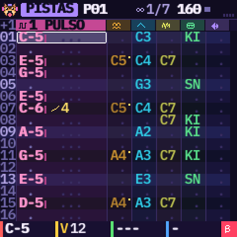
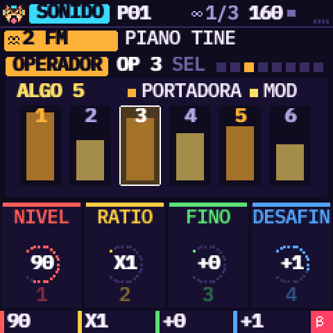
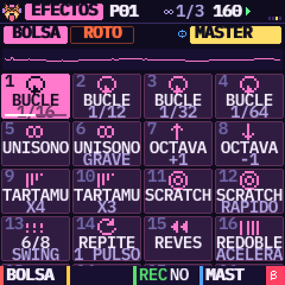
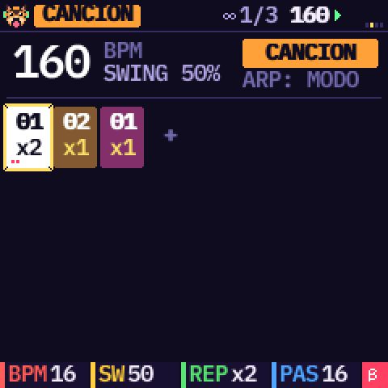
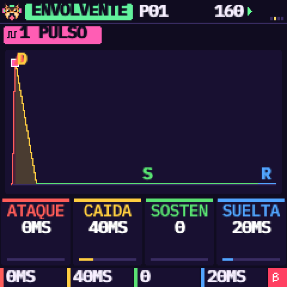
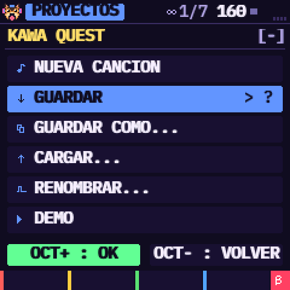

# KAWA — Pocket Tracker by Omnipotard


[English](README.md) · [Français](README.fr.md) · **Español**

KAWA es un firmware tracker para el **M-VAVE FM-1**, para componer en cualquier estilo: pop, techno, hip hop,
ambient, jazz, rock, música de videojuegos, chiptune, breakcore… Tiene seis pistas, cada una con su motor: pulso, onda de 4 bits, ruido, FM de 6 operadores, kit de batería o sample.
Escribes patrones, los encadenas en una canción y tocas 32 efectos en directo al estilo de un Pocket
Operator. Unas herramientas «mágicas» escriben ritmos, melodías y cortes de break por ti. La pantalla habla
español, inglés o francés.

| | | |
| --- | --- | --- |
|  |  |  |
|  |  |  |

> **Estado: 0.4, beta.** KAWA compila para el FM-1 y pasa todas las comprobaciones de su plataforma: tamaño,
> memoria, acceso al hardware, y una instalación probada con cortes de corriente simulados. Funciona en el
> simulador y en el emulador web. **Todavía no se ha probado en un FM-1 real.** Instalar un firmware no
> oficial es bajo tu responsabilidad: lee [Instalar](#instalar) y
> [Volver al firmware oficial](#volver-al-firmware-oficial) antes de empezar.

**El manual**, con tutoriales ilustrados (una canción nueva, escribir un patrón, encadenar patrones,
guardar): [manual/es.html](manual/es.html) ([EN](manual/index.html),
[FR](manual/fr.html)).

## Componer con un tracker

Un tracker es una forma de componer muy distinta de un programa de música habitual (un DAW):

- **El tiempo baja.** Cada fila es un paso (una semicorchea), cada columna una pista, y cada celda dice qué
  tocar en ese paso exacto: una nota, su volumen y un efecto. Lees la canción como una partitura que se
  desplaza.
- **Escribes con el teclado,** nota a nota, en el sitio exacto, sin ratón ni piano roll: la rejilla es siempre
  la misma.
- **Los efectos se escriben en la celda,** al paso (arpegio, glissando, redoble, volumen…), en lugar de curvas
  de automatización.
- **La canción es una lista de patrones cortos,** cada uno tocado N veces, en lugar de clips en una línea de
  tiempo.

El manual lo explica con la pantalla delante, y luego recorre todo el camino, de una canción vacía a una
terminada.

## Pruébalo en el navegador

El propio firmware, compilado en WebAssembly, funciona en [`emulator/index.html`](emulator/index.html), con
el panel del FM-1 alrededor. Pulsa **ENCENDER** y luego **PLAY**: suena la demo «KAWA QUEST». Puedes soltar
tus propios sonidos en él y enviarlos a tu FM-1 por USB.

## Qué trae

- **Un tracker de verdad.** 32 patrones de 1 a 32 filas, dos efectos en cada celda, entre 17 (arpegio,
  glissando, vibrato, redoble, bend, azar, retardo, corte, reverso, tono, forma, triturar, deslizar el volumen,
  panorama, inicio en el sample, salto a una fila, fin del patrón), un salto de filas ajustable (REC
  mantenido + SELECT), insertar y borrar filas, solo, deshacer y rehacer (SAVE mantenido + OCT− / OCT+).
- **Tablas y un groove, como en el M8.** Cada pista tiene una tabla: 16 pasos que suenan dentro de cada nota
  (altura, volumen, un efecto cada uno: GOLPE, CORTE, VIBRATO…), para arpegios chiptune, redobles, caídas de
  altura. El groove ajusta los ticks de cada fila por turnos (7 5, 8 4, 4 4 4…), en lugar del swing.
- **Una cadena que hace una canción.** Cada paso de la cadena toca un patrón de 1 a 16 veces; la herramienta
  CLONAR hace una variación con una tecla y la añade a la cadena.
- **Un menú de proyectos de verdad.** Canción nueva, guardar, guardar como (ranura y nombre), cargar,
  renombrar, demo. Hay cuatro ranuras, una de ellas de guardado automático.
- **Seis motores a elegir por pista**, con SELECT en la página SONIDO. La pista FM (solo una, para dejarle
  margen al FM-1) ajusta sus 6 operadores uno a uno.
- **Diseño de sonido.** Cada sonido tiene una ADSR dibujada con los colores de los potenciómetros, un efecto
  propio (filtros, distorsión, triturar, diezmar, anillo, trémolo, wah), un LFO sincronizado con el tempo y
  una página MODULACIÓN. El máster tiene su efecto, una reverb, un eco y un limitador. Un editor de sample
  ajusta dónde empieza y termina un sample, coloca sus cortes a mano, lo normaliza y lo toca al revés, sin
  tocar el sonido.
- **8 kits de batería** sintetizados: acústico, hip hop, techno, dub-reggae, lo-fi, Game Boy, SNES y
  percusión. Además, **seis breaks** originales para cortar en 16 trozos (SOLEIL, GRELOT, TENDU, ABYSSE,
  MAMBO, GRENIER: cada uno con su groove, su batería y su disco), y **tus propios samples** (4 ranuras).
- **Un potenciómetro, un color.** KNOB 1 rojo, 2 amarillo, 3 verde, 4 azul, en todas las páginas. La línea de
  abajo dice qué hace cada uno. HOME mantenido abre la ayuda de la página en la que estás.
- **Tres temas** (KAWA, GAME BOY, BONBON), **cuatro fuentes de pantalla** (SUAVE, BASE, CLARA, 8-BIT), el **reloj MIDI** de salida o de entrada (KAWA sigue el tempo y el
  START / STOP de otra máquina) y un indicador de CPU.
- **Un perro** con cascos que te recibe al encender y vive en la esquina de la pantalla.

## Instalar

Necesitas un cable USB de datos y Python 3 ([python.org](https://www.python.org/downloads/)). Enciende el
FM-1, conéctalo, cierra cualquier otro programa MIDI y abre el instalador de tu ordenador:

- **Windows:** doble clic en `INSTALL-Windows.bat`
- **Mac:** doble clic en `INSTALL-Mac.command` (la primera vez: clic derecho y Abrir)
- **Linux:** `./INSTALL-Linux.sh` en un terminal

La primera vez descarga lo que necesita (rtmidi2, en `install/.venv`). Busca el FM-1, pregunta antes de
escribir `install/kawa-0.4.fwsc` y reinicia el FM-1 en KAWA. A mano:

```sh
pip3 install rtmidi2                                  # (Python 3.9 o anterior: pip3 install mido python-rtmidi)
python3 install/fm1_install.py --info                 # qué ejecuta el FM-1 conectado
python3 install/fm1_install.py install/kawa-0.4.fwsc  # pregunta antes de escribir y reinicia en KAWA
```

Lo que protege tu FM-1:

- El paquete se comprueba entero antes de borrar nada. Un paquete dañado se rechaza y el firmware anterior
  se queda.
- El bootloader del chip nunca se escribe.
- Una instalación cortada se reanuda al volver a encender.
- Mantén **OCT−** al encender para el rescate USB. Si KAWA falla dos veces al arrancar, el FM-1 va ahí solo.

Los detalles están en [BUILDING.md](source/BUILDING.md) (en inglés) y en el manual.

## Volver al firmware oficial

1. Los proyectos de KAWA se perderán: el firmware oficial no sabe leerlos.
2. Conecta el FM-1 a una alimentación estable, con un cable USB de datos.
3. Instala el firmware oficial **V15** de M-VAVE con **M-UPGRADE**. Si KAWA se comporta mal, abre primero el
   rescate USB (OCT− mantenido al encender).
4. Antes de que la herramienta oficial escriba nada, KAWA comprueba que es el programa de actualización de
   M-VAVE, y que la zona de arranque del paquete es exactamente la de tu FM-1. Si no, no se escribe nada y
   KAWA sigue funcionando.
5. **No desconectes nada durante la transferencia.** Es el paso más delicado, porque el firmware oficial
   también reescribe el bootloader. Si se detiene, vuelve a conectar y empieza de nuevo.
6. `python3 install/fm1_install.py --info` debe responder `FM-1_015`.

## Tus samples en el FM-1

```sh
python3 install/kawa_samples.py put 1 mi-sonido.wav   # en MI 1 (KAWA parado)
python3 install/kawa_samples.py list
```

El sonido se pasa a mono, a 22 kHz y se normaliza, hasta 1,66 s por ranura. En una pista SAMPLE, elige
FUENTE = MI 1 a 4.

## Compilarlo

Desde la carpeta `source/`:

- `tests/run_host.sh [script]` ejecuta KAWA en tu ordenador: pantallas en PNG, sonido en WAV.
- `web/make_emulator.sh` construye el emulador web. Necesita clang con el destino wasm32, y wasm-ld.
- `./build.sh` construye el paquete del FM-1. Necesita el compilador de JieLi (`tools/get_toolchain.sh`) y
  tres archivos del SDK JieLi AC79. Ver [BUILDING.md](source/BUILDING.md).
- `tests/run_loader_tests.sh` prueba la instalación: paquetes dañados, cortes de corriente, un chip
  desconocido.
- `tests/run_kits_test.sh` y `tests/breaks_check.py` miden los kits de batería y los breaks.
- `tests/run_features_test.sh` toca el salto, el fin de patrón, dos efectos en una celda, las tablas, el
  groove, la edición de sample y el reloj MIDI de entrada en la interrupción de audio;
  `tests/run_format_test.sh` carga proyectos guardados por la 0.2.
- `tests/run_stress_test.sh` toca cada sonido, efecto, efecto en directo, tabla y groove en los extremos de sus
  potenciómetros (17 minutos de sonido) bajo UBSan, y se detiene en el primer número que desborda (un clic en
  el FM-1).

## Apoyar KAWA

KAWA es libre y gratuito. Si te gusta lo que hago, ¡piensa en apoyarme! ¡Cada pequeño gesto significa
muchísimo! **[Invítame a una cerveza en Ko-fi](https://ko-fi.com/omnipotard)**.

## Créditos y licencia

KAWA por Omnipotard. GPL-3.0-only: puedes usarlo, modificarlo y compartirlo, y quien reciba un firmware
construido a partir de él recibe también su código fuente. Se basa en [Dinghy](https://github.com/zvenson/dinghy)
(zvenson), [Felucca](https://github.com/hugelton/Felucca) (Leo Kuroshita, Hügelton Instruments) y
[SLOOP](https://github.com/isod89/sloop-fm1) (isod89). El motor FM es msfa (Dexed, Apache-2.0), en el
porte de Felucca. Los detalles están en [LICENSING.md](LICENSING.md). «M-VAVE» y «FM-1» pertenecen a sus
propietarios; KAWA no está hecho ni respaldado por ellos.
