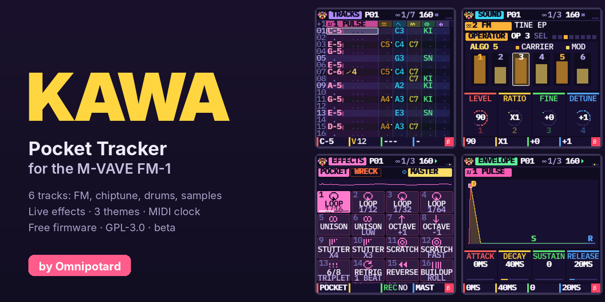
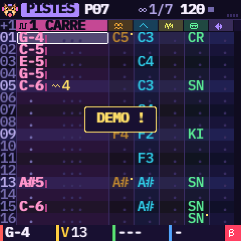
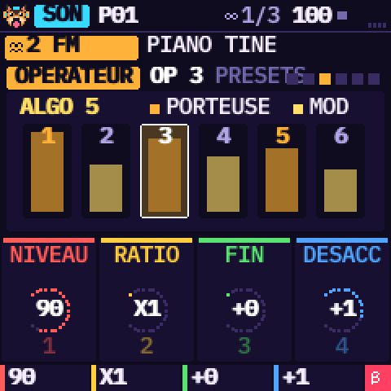
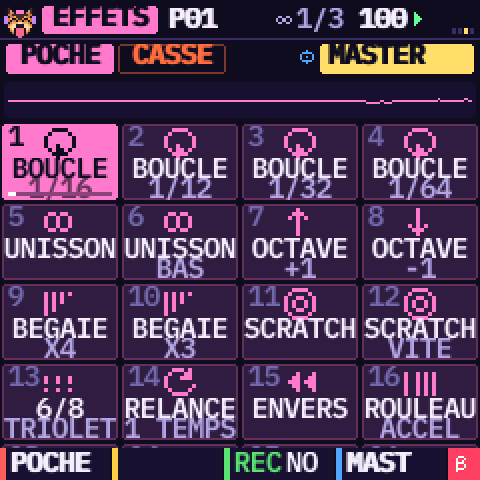
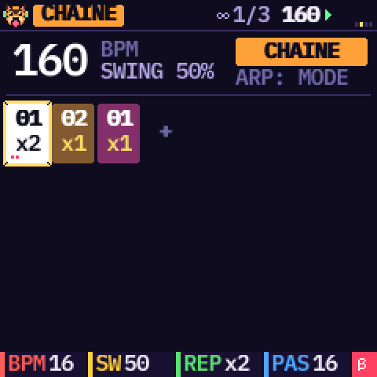
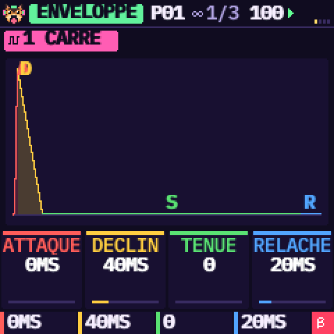
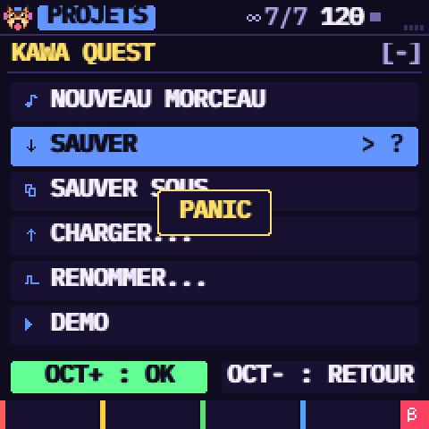
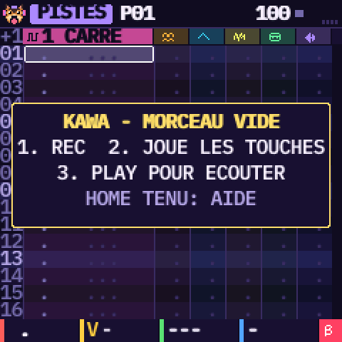
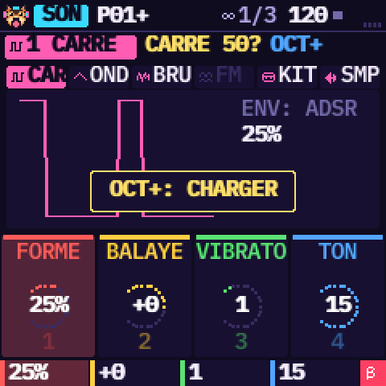
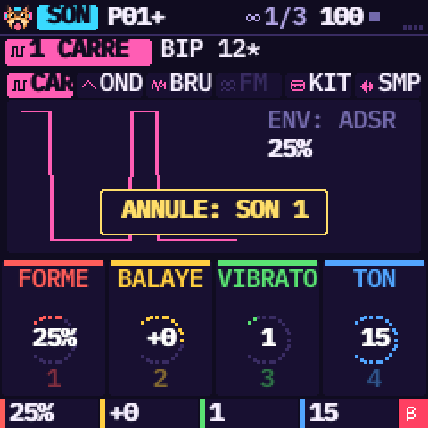

# KAWA — Pocket Tracker by Omnipotard



**[▶ Ouvrir le site de KAWA](https://guizmoh.github.io/Kawa-Tracker-Fm1/)** — [Installer](https://guizmoh.github.io/Kawa-Tracker-Fm1/#install) · [Émulateur](https://guizmoh.github.io/Kawa-Tracker-Fm1/emulator/index.html) · [Manuel](https://guizmoh.github.io/Kawa-Tracker-Fm1/manual/fr.html) · [Samples](https://guizmoh.github.io/Kawa-Tracker-Fm1/samples.html)

[English](README.md) · **Français** · [Español](README.es.md)

KAWA est un firmware tracker pour le **M-VAVE FM-1**, fait avant tout pour la **chiptune et l'IDM** : ondes
4 bits, carré et bruit comme les vieilles consoles, FM, breakbeats découpés en tranches, roulements et ratchets,
effets live de stutter, scratch, retrig et montée, tables, groove, outils Euclide et hasard, une saturation sur
chaque piste. (Il sait faire d'autres styles, mais c'est pour ça qu'il est construit.) Il a six pistes, chacune
avec son moteur : carré, onde 4 bits, bruit, FM à 6 opérateurs, kit de batterie ou sample. Tu écris des motifs,
tu les enchaînes en morceau, et tu joues 32 effets en direct façon Pocket Operator. Des outils « magiques »
écrivent des beats, des mélodies et des découpes de break à ta place. L'écran parle français, anglais ou
espagnol.

| | | |
| --- | --- | --- |
|  |  |  |
|  |  |  |

> **État : 0.5, bêta.** KAWA compile pour le FM-1 et passe toutes les vérifications de sa plateforme :
> taille, mémoire, accès au matériel, chemin d'installation testé avec des coupures de courant simulées.
> Il tourne dans le simulateur et dans l'émulateur web. Il n'a **pas encore été essayé sur un vrai FM-1**.
> Installer un firmware non officiel se fait à tes risques : lis [Installer](#installer) et
> [Revenir au firmware officiel](#revenir-au-firmware-officiel) avant de commencer.

**Le manuel**, avec des tutoriels illustrés (un nouveau morceau, écrire un motif, enchaîner les motifs,
sauvegarder) : [manual/fr.html](manual/fr.html) ([EN](manual/index.html),
[ES](manual/es.html)).

## Composer avec un tracker

Un tracker est une façon de composer très différente d'un logiciel de musique habituel (un DAW) :

- **Le temps descend.** Chaque ligne est un pas (une double croche), chaque colonne une piste, et chaque case
  dit quoi jouer à ce pas précis : une note, son volume et un effet. On lit le morceau comme une partition qui
  défile.
- **On écrit au clavier,** note par note, à l'endroit exact, sans souris ni piano roll : la grille est
  toujours la même.
- **Les effets s'écrivent dans la case,** au pas près (arpège, glissé, roulement, volume…), au lieu de
  courbes d'automation.
- **Le morceau est une liste de motifs** courts, chacun joué N fois, au lieu de clips posés sur une timeline.

Le manuel l'explique avec l'écran sous les yeux, puis montre tout le chemin, d'un morceau vide à un morceau
complet.

## L'essayer dans le navigateur

Le firmware lui-même, compilé en WebAssembly, tourne dans [`emulator/index.html`](emulator/index.html),
avec le panneau du FM-1 autour. Appuie sur **ALLUMER**, puis sur une touche (l'écran de démarrage t'attend) :
KAWA démarre sur un morceau vide, avec une petite aide à l'écran jusqu'à la première note. Pour entendre la
démo « KAWA QUEST », appuie sur **SAVE**, choisis DEMO dans le menu PROJETS (**OCT+** valide), puis appuie sur
**PLAY**. Tu peux y glisser tes propres sons et les envoyer à ton FM-1 par USB.

## Ce qu'il y a dedans

- **Un vrai tracker.** 32 motifs de 1 à 32 lignes, deux effets dans chaque case, parmi 17 (arpège, glissé,
  vibrato, roulé, bend, chance, retard, coupe, envers, hauteur, forme, écrase, glissé de volume, pano, départ
  dans le sample, saut à une ligne, fin du motif), un saut de lignes réglable (REC tenu + SELECT),
  l'insertion et la suppression de lignes, le solo, et 10 pas d'annuler / refaire qui couvrent aussi les sons
  (SAVE tenu + OCT− / OCT+).
- **Des tables et un groove, comme sur le M8.** Chaque piste a une table : 16 pas joués dans chaque note
  (hauteur, volume, un effet chacun : FRAPPE, COUPE, VIBRATO…), pour des arpèges chiptune, des roulements,
  des chutes de hauteur. Le groove règle les ticks de chaque ligne tour à tour (7 5, 8 4, 4 4 4…), à la
  place du swing.
- **Une chaîne qui fait un morceau.** Chaque case de la chaîne joue un motif de 1 à 16 fois ; l'outil
  CLONER fait une variation en une touche et l'ajoute à la chaîne.
- **Un vrai menu de projets.** Nouveau morceau, sauver, sauver sous (emplacement et nom), charger,
  renommer, démo. Il y a quatre emplacements, dont un de sauvegarde automatique.
- **Six moteurs au choix par piste,** sur la page SON : PRESETS fait défiler les sons d'usine, rangés par
  moteur, et ARP tenu + PRESETS saute au moteur suivant. La piste FM (une seule, pour garder de la marge au
  FM-1) règle ses 6 opérateurs un par un.
- **Du sound design.** Chaque son a une ADSR dessinée dans les couleurs des potards, un effet rien qu'à
  lui (filtres, disto, écrase, décime, anneau, trémolo, wah), un LFO calé sur le tempo et une page
  MODULATION (tous deux sur le bouton LFO). Le master a son effet, une réverb, un écho et un limiteur. Un éditeur de sample règle où un
  sample commence et finit, place ses tranches à la main, le normalise et le joue à l'envers, sans toucher
  au son.
- **8 kits de batterie** synthétisés : acoustique, hip hop, techno, dub-reggae, lo-fi, Game Boy, SNES et
  percussions. S'y ajoutent **six breaks** originaux à découper en 16 tranches (SOLEIL, GRELOT, TENDU,
  ABYSSE, MAMBO, GRENIER : chacun son groove, sa batterie et son disque), et **tes propres samples**
  (4 emplacements).
- **Un potard, une couleur.** KNOB 1 rouge, 2 jaune, 3 vert, 4 bleu, sur toutes les pages. La ligne du bas
  dit ce que fait chacun. HOME tenu ouvre l'aide de la page où tu es.
- **Trois thèmes** (KAWA, GAME BOY, BONBON), **quatre polices d'écran** (DOUCE, BASE, CLAIRE, 8-BIT), l'**horloge MIDI** en sortie ou en entrée (KAWA suit le tempo
  et le START / STOP d'une autre machine), et un indicateur CPU.
- **Un chien** à casque qui t'accueille au démarrage et vit dans le coin de l'écran.

### Nouveautés de la 0.5

- **Elle démarre sur un morceau vide** à 100 BPM. L'écran de démarrage attend une touche, un bouton ou un
  potard (ce premier appui ne fait que le fermer), puis un cadre sur PISTES dit quoi faire (REC, joue les
  touches, PLAY ; HOME tenu : l'aide) jusqu'à la première note. La sauvegarde automatique te rend ton dernier
  travail après une coupure, et la démo est à une touche : SAVE, PROJETS, DEMO.
- **Une page ENVOIS** (bouton FX) : pour chaque piste, **SATURE** (une saturation douce), **ECHO** et
  **REVERB**, de 0 à 15. FX encore : les 32 effets LIVE ; FX tenu : LIVE tant que tu le tiens.
- **SAVE tenu ouvre les outils :** OPTIONS, ANNULER, REFAIRE, EFFACER, COPIER, COLLER et HASARD (une mélodie,
  une basse, un beat ou une découpe de break qui va à la piste), sur la piste en cours ou sur tout le motif.
  SELECT en choisit un, il se lance quand tu relâches. Un appui court ouvre toujours PROJETS.
- **Annuler marche aussi sur les sons.** Chaque tour de potard sur une page de son (de SON à TABLE, ENVELOPPE,
  MIX, LFO, MODULATION), les envois et chaque son d'usine chargé s'annulent ; une rafale de tours fait un seul
  pas. Motifs et sons partagent 10 pas d'historique. L'écran dit « ANNULE: SON 3 » et va sur cette piste.
- **SAVE clignote** tant qu'il y a des changements pas sauvés.
- **HOME + PLAY : panique.** Le morceau s'arrête, chaque voix et chaque effet live est coupé.
- **Un métronome** avec son volume (GLO, troisième page, OPTIONS) : non, oui, ou seulement pendant
  l'enregistrement. Le clic sort aussi dans l'audio USB : coupe-le quand tu enregistres le FM-1 sur un
  ordinateur.
- **16, 32 ou 64 pas** par motif (OCT− / OCT+ sur la grille). 64 pas relient un motif au suivant, et l'en-tête
  jaune dit où tu es (« 49-64/64 »).
- **Une barre jaune, avec son nom,** se remplit en bas de l'écran quand tenir un bouton va ouvrir quelque chose
  (HOME : AIDE, FX : LIVE, SAVE : OUTILS). Un appui court n'affiche rien. Tiens FX et appuie tout de suite sur une
  touche : cet effet live joue sans attendre la barre.
- **Les pages par bouton.** Le bouton LFO a les pages LFO et MODULATION, **MAGIE passe sur SCL** (GAMME, MAGIE,
  PISTES), et SELECT tourne les pages de EDIT, LFO, ENV, FX et GLO.
- **Pas de son changé par erreur.** Un son modifié porte une `*` après son nom. PRESETS ne le remplace pas : il
  montre seulement le son d'usine suivant en doré, avec « ? » et « OCT+ ». Continue de tourner pour parcourir,
  **OCT+** le charge, **OCT−** garde le tien (un potard, une autre piste ou page, ou 8 secondes sans toucher le
  gardent aussi). Un son pas touché change tout de suite.

| | | |
| --- | --- | --- |
|  |  |  |

## Les commandes d'un coup d'œil

| Bouton | Ce qu'il fait |
| --- | --- |
| **HOME** | Les pistes. Tenu : l'aide de la page où tu es. **HOME + PLAY** : panique (le morceau s'arrête, tout son est coupé) |
| **SEQ** | La grille de pas, 16 pas par page (encore : retour aux pistes). **OCT− / OCT+** y règlent la taille du motif : 16, 32 ou 64 pas |
| **EDIT** | SON, SON 2, puis OPÉRATEUR et ENV OPÉRAT (piste FM) ou SAMPLE (piste sample), EFFET, TABLE. Appuie encore : page suivante |
| **LFO** | LFO, puis MODULATION |
| **ENV** | ENVELOPPE, puis MIX |
| **FX** | ENVOIS (saturation, écho, réverb par piste), puis LIVE (les 32 effets en direct), puis retour. Tenu : LIVE tant que tu le tiens |
| **SCL** | GAMME, puis MAGIE (beats, mélodies, découpes de break), puis retour aux pistes |
| **GLO** | CHAÎNE, puis GROOVE, puis OPTIONS (thème, langue, horloge MIDI, police, métronome) |
| **SAVE** | Le menu PROJETS (il clignote tant qu'il y a des changements pas sauvés). Tenu (la barre jaune se remplit) : les outils. **OCT− / OCT+** pendant qu'il est tenu : annuler / refaire, pour les motifs et les sons |
| **OCT− / OCT+** | L'octave des touches. Sur LIVE : la banque. Sur la chaîne : ajouter / retirer une case. Dans PROJETS : OK / retour. Sur SON, quand un son d'usine est montré en doré : OCT+ le charge, OCT− garde le tien |
| **PLAY**, **REC** | Jouer / arrêter ; enregistrer (les touches écrivent au curseur). REC tenu + SELECT : de combien de lignes saute une note |
| **ARP** | Pas un arpégiateur : le bouton **effacer / Maj** de KAWA. Un appui sur PISTES efface la case. Tenu : + SELECT insère ou supprime une ligne (+ ALGORITHM : dans tout le motif), + KNOB 3 / 4 règle le deuxième effet de la case, + une touche noire sur MIX met une piste en solo, + PRESETS sur SON choisit le moteur suivant. Il efface aussi un pas de la grille, un pas de table ou la voie LIVE, égalise les tranches dans SAMPLE et bascule BOUCLE / CHAÎNE sur la chaîne |

| Encodeur | Ce qu'il fait |
| --- | --- |
| **SELECT** | Sur EDIT, LFO, ENV / MIX, FX et GLO : tourne les pages du groupe du bouton. Ailleurs : la ligne (PISTES), la page de 16 pas (grille), le menu (PROJETS) |
| **ALGORITHM** | La piste (sur MIX, jusqu'au master). Sur CHAÎNE la case de la chaîne, sur GROOVE le pas, sur OPTIONS le mode du métronome |
| **PRESETS** | Sur la première page SON : le son d'usine (sur un son modifié, il montre seulement le suivant en doré : OCT+ le charge). Sur les autres pages EDIT : le curseur de la page (opérateur, ligne de table, tranche). Ailleurs : le motif ; sur OPTIONS, le volume du métronome |
| **KNOB 1 à 4** | Rouge, jaune, vert, bleu, sur toutes les pages. La ligne du bas dit ce que fait chacun |

Les 27 touches (16 blanches, 11 noires) jouent des notes sur la piste en cours.

## Installer

Le firmware à installer est le fichier [`kawa-0.5.fwsc`](kawa-0.5.fwsc) tout en haut de cette page (le même fichier est dans `install/`).

La [page d'accueil](index.html) du projet a aussi un bouton **Install** : il installe KAWA directement depuis
Chrome ou Edge (Web MIDI). À côté, l'[importateur de samples](samples.html) envoie tes propres sons à KAWA de
la même manière (voir [Tes samples sur le FM-1](#tes-samples-sur-le-fm-1)). L'autre façon, ce sont les
lanceurs ci-dessous, qui demandent un câble USB de
données et Python 3 ([python.org](https://www.python.org/downloads/)). Allume le FM-1, branche-le, ferme tous
les autres programmes MIDI, puis lance l'installateur de ton ordinateur :

- **Windows :** double-clic sur `INSTALL-Windows.bat`
- **Mac :** double-clic sur `INSTALL-Mac.command` (la première fois : clic droit, puis Ouvrir)
- **Linux :** `./INSTALL-Linux.sh` dans un terminal

La première fois, il récupère ce qu'il lui faut (rtmidi2, dans `install/.venv`). Il trouve le FM-1, demande
avant d'écrire `install/kawa-0.5.fwsc`, puis redémarre le FM-1 sur KAWA. À la main :

```sh
pip3 install rtmidi2                                  # (Python 3.9 et avant : pip3 install mido python-rtmidi)
python3 install/fm1_install.py --info                 # ce que tourne le FM-1 branché
python3 install/fm1_install.py install/kawa-0.5.fwsc  # demande avant d'écrire, puis redémarre sur KAWA
```

Ce qui protège ton FM-1 :

- Le paquet est vérifié en entier avant d'effacer quoi que ce soit. Un paquet abîmé est refusé, et
  l'ancien firmware reste.
- Le bootloader de la puce n'est jamais écrit.
- Une installation coupée reprend au rallumage.
- Tiens **OCT−** en allumant pour le secours USB. Si KAWA plante deux fois au démarrage, le FM-1 y va
  tout seul.

Le détail est dans [BUILDING.md](source/BUILDING.md) (en anglais) et dans le manuel.

## Revenir au firmware officiel

1. Les projets KAWA seront perdus : le firmware officiel ne sait pas les lire.
2. Branche le FM-1 sur une alimentation stable, avec un câble USB de données.
3. Installe le firmware officiel **V15** de M-VAVE avec **M-UPGRADE**. Si KAWA se comporte mal, ouvre
   d'abord le secours USB (OCT− tenu en allumant).
4. Avant que l'outil officiel n'écrive quoi que ce soit, KAWA vérifie que c'est bien le programme de mise
   à jour de M-VAVE, et que la zone de démarrage du paquet est exactement celle de ton FM-1. Sinon, rien
   n'est écrit et KAWA continue de tourner.
5. **Ne débranche rien pendant le transfert.** C'est l'étape la plus délicate, car le firmware officiel
   réécrit aussi le bootloader. S'il s'arrête, rebranche et relance.
6. `python3 install/fm1_install.py --info` doit répondre `FM-1_015`.

## Tes samples sur le FM-1

Dans Chrome ou Edge, l'[importateur de samples](samples.html) (en anglais) fait tout dans le navigateur : dépose
des fichiers WAV, MP3, OGG ou FLAC, il les convertit et en envoie jusqu'à quatre dans les emplacements MON 1 à
MON 4 de KAWA (MY 1 à MY 4 sur la page) par USB (KAWA à l'arrêt). Depuis un terminal :

```sh
python3 install/kawa_samples.py put 1 mon-son.wav     # dans MON 1 (KAWA à l'arrêt)
python3 install/kawa_samples.py list
```

Le son est mis en mono, en 22 kHz et normalisé, jusqu'à 1,66 s par emplacement. Sur une piste SAMPLE,
choisis SOURCE = MON 1 à 4.

## Le compiler

Depuis le dossier `source/` :

- `tests/run_host.sh [script]` fait tourner KAWA sur ton ordinateur : écrans en PNG, son en WAV.
- `web/make_emulator.sh` construit l'émulateur web. Il faut clang avec la cible wasm32, et wasm-ld.
- `./build.sh` construit le paquet FM-1. Il faut le compilateur JieLi (`tools/get_toolchain.sh`) et trois
  fichiers du SDK JieLi AC79. Voir [BUILDING.md](source/BUILDING.md).
- `tests/run_loader_tests.sh` teste le chemin d'installation : paquets abîmés, coupures de courant, puce
  inconnue.
- `tests/run_kits_test.sh` et `tests/breaks_check.py` mesurent les kits de batterie et les breaks.
- `tests/run_features_test.sh` joue le saut, la fin de motif, deux effets dans une case, les tables, le groove,
  l'édition de sample et l'horloge MIDI en entrée dans l'interruption audio ; `tests/run_format_test.sh`
  charge des projets sauvés par la 0.2.
- `tests/run_ui_test.sh` pilote le panneau comme le feraient les boutons et les encodeurs : l'écran de démarrage
  et le départ à vide, les pages de chaque bouton et ce que fait SELECT dessus, les sons protégés et l'annulation
  des sons, ENVOIS, les appuis tenus et les outils, la panique, le métronome et les 16 / 32 / 64 pas. `node tests/webinstall_test.js` teste l'installateur web
  derrière le bouton Install contre un FM-1 simulé (Node tout simple, sans matériel).
- `tests/run_stress_test.sh` joue chaque son, effet, effet live, table et groove aux bouts de leurs potards
  (environ 18 minutes de son) sous UBSan, et s'arrête au premier nombre qui déborde (un clic sur le FM-1).

## Soutenir KAWA

KAWA est gratuit et libre. Si tu aimes ce que je fais, pense à me soutenir ! Chaque petit geste compte
énormément. **[Paye-moi une bière sur Ko-fi](https://ko-fi.com/omnipotard)**.

## Crédits et licence

KAWA par Omnipotard. GPL-3.0-only : tu peux l'utiliser, le modifier et le partager, et qui reçoit un
firmware construit à partir de lui reçoit aussi son code source. Il repose sur
[Dinghy](https://github.com/zvenson/dinghy) (zvenson), [Felucca](https://github.com/hugelton/Felucca)
(Leo Kuroshita, Hügelton Instruments) et [SLOOP](https://github.com/isod89/sloop-fm1) (isod89). Le moteur
FM est msfa (Dexed, Apache-2.0), dans le portage de Felucca. Les détails sont dans
[LICENSING.md](LICENSING.md). « M-VAVE » et « FM-1 » appartiennent à leurs propriétaires ; KAWA n'est ni fait
ni approuvé par eux.
