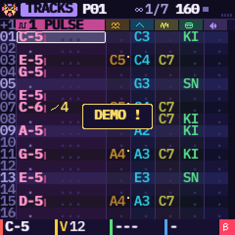
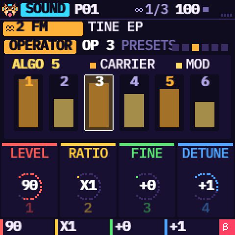
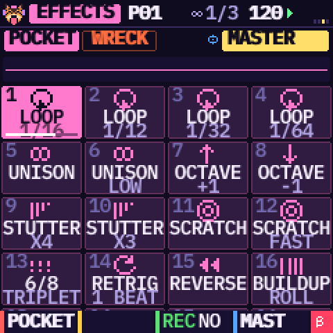
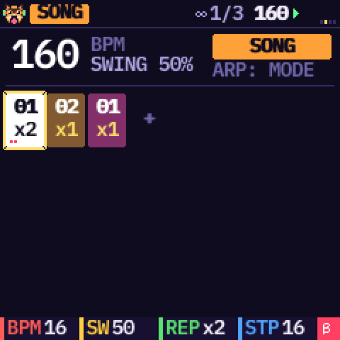
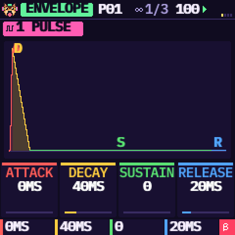
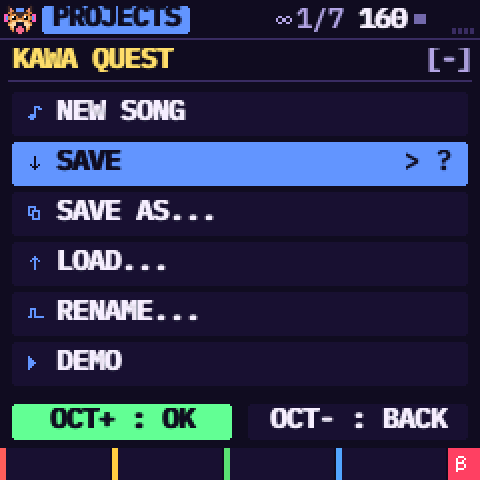
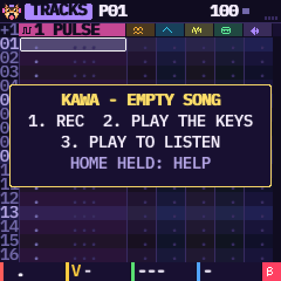
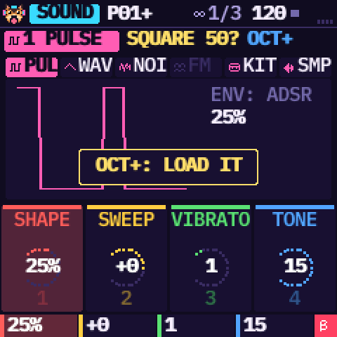
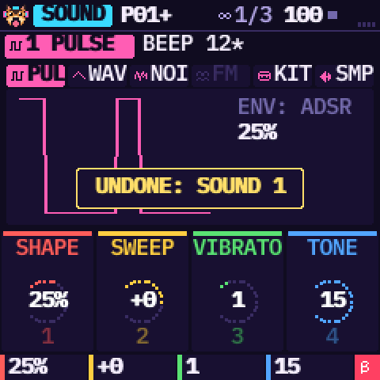

# KAWA — Pocket Tracker by Omnipotard


**English** · [Français](README.fr.md) · [Español](README.es.md)

KAWA is a tracker firmware for the **M-VAVE FM-1**, made above all for **chiptune and IDM**: 4-bit waves,
pulse and noise like the old consoles, FM, breakbeats cut into slices, rolls and ratchets, stutter, scratch,
retrig and build-up live effects, tables, a groove, Euclid and random tools, a drive on every track. (It can do
other styles, but that is what it is built for.) It has six tracks, each with its own engine: pulse, 4-bit
wave, noise, 6-operator FM, drum kit or sample. You write patterns, chain them into a song, and play 32 live
effects in the style of a Pocket Operator. "Magic" tools write beats, melodies and break chops for you. The
screen speaks English, French or Spanish.

| | | |
| --- | --- | --- |
|  |  |  |
|  |  |  |

> **Status: 0.5, beta.** KAWA builds for the FM-1 and passes every check of its platform: size, memory,
> hardware access, and an install path tested against simulated power cuts. It runs in the simulator and in
> the web emulator. It has **not been tried on a real FM-1 yet**. Installing an unofficial firmware is at
> your own risk: read [Install](#install) and [Back to the official firmware](#back-to-the-official-firmware)
> before you start.

**The manual**, with illustrated tutorials (a new song, writing a pattern, chaining patterns, saving):
[manual/index.html](manual/index.html) ([FR](manual/fr.html), [ES](manual/es.html)).

## Composing with a tracker

A tracker is a way of composing that is very different from the usual music software (a DAW):

- **Time runs down.** Each row is a step (a sixteenth note), each column a track, and each cell says what to
  play at that exact step: a note, its volume and an effect. You read the song like a scrolling score.
- **You write with the keys,** note by note, at the exact spot, with no mouse and no piano roll: the grid is
  always the same.
- **Effects are written in the cell,** to the step (arpeggio, glide, roll, volume…), instead of automation
  curves.
- **The song is a list of short patterns,** each played N times, instead of clips laid on a timeline.

The manual explains it with the screen in front of you, then walks the whole way, from an empty song to a
finished one.

## Try it in your browser

The firmware itself, compiled to WebAssembly, runs in [`emulator/index.html`](emulator/index.html), with
the FM-1's panel around it. Press **POWER ON**, then any key (the boot screen waits for you): KAWA starts on
an empty song, with a short hint on the screen until the first note. To hear the "KAWA QUEST" demo,
tap **SAVE**, pick DEMO in the PROJECTS menu (**OCT+** confirms), then press **PLAY**. You can drop your own
sounds on it and send them to your FM-1 over USB.

## What's inside

- **A real tracker.** 32 patterns of 1 to 32 rows, two effects in every cell, out of 17 (arpeggio, glide,
  vibrato, roll, bend, chance, delay, cut, reverse, pitch, shape, crush, volume slide, pan, sample offset,
  HOP to a row, END of the pattern), an adjustable row step (REC held + SELECT), inserting and deleting rows,
  solo, and 10 steps of undo and redo that cover the sounds too (SAVE held + OCT− / OCT+).
- **Tables and a groove, as on the M8.** Each track has a table: 16 steps played inside every note (pitch,
  volume, a trick each: HIT, CUT, VIB…), for chip arpeggios, rolls, pitch drops. The groove sets the ticks of
  each row in turn (7 5, 8 4, 4 4 4…), in place of the swing.
- **A chain that makes a song.** Each step of the chain plays a pattern 1 to 16 times; the CLONE tool makes
  a variation in one key press and adds it to the chain.
- **A real projects menu.** New song, save, save as (slot and name), load, rename, demo. There are four
  slots, one of them the autosave.
- **Six engines, chosen per track** on the SOUND page: PRESETS scrolls the factory sounds, grouped by engine,
  and ARP held + PRESETS jumps to the next engine. The FM track (only one, to keep the FM-1 some headroom)
  sets its 6 operators one by one.
- **Sound design.** Every sound has an ADSR drawn in the knobs' colours, an effect of its own (filters,
  distortion, crush, decimate, ring, tremolo, wah), an LFO locked to the tempo and a MODULATION page (both on the LFO button). The
  master has its own effect, a reverb, an echo and a limiter. A sample editor sets where a sample starts and
  ends, places its slices by hand, normalises it and plays it backwards, without touching the sound.
- **8 drum kits**, synthesised: acoustic, hip hop, techno, dub-reggae, lo-fi, Game Boy, SNES and percussion.
  Then **six original breaks** to cut into 16 slices (SOLEIL, GRELOT, TENDU, ABYSSE, MAMBO, GRENIER: each its
  own groove, kit and record), and **your own samples** (4 slots).
- **One knob, one colour.** KNOB 1 red, 2 yellow, 3 green, 4 blue, on every page. The bottom line says what
  each one does. HOME held opens the help of the page you are on.
- **Three themes** (KAWA, GAME BOY, BONBON), **four screen fonts** (SMOOTH, BASIC, CLEAR, 8-BIT), the **MIDI clock** out or in (KAWA follows another machine's
  tempo and START / STOP), and a CPU meter.
- **A dog** with headphones who greets you at power-on and lives in the corner of the screen.

### New in 0.5

- **It starts on an empty song** at 100 BPM. The boot screen waits for any key, button or knob (that first touch
  only closes it), then a box on TRACKS says what to do (REC, play the keys, PLAY; HOME held: help) until the
  first note. The autosave still brings your last work back after a power-off, and the demo is one tap away:
  SAVE, PROJECTS, DEMO.
- **A SENDS page** (FX button): for each track, **DRIVE** (a soft saturation), **ECHO** and **REVERB**, from 0 to
  15. FX again: the 32 LIVE effects; FX held: LIVE while you hold it.
- **Hold SAVE for the tools:** OPTIONS, UNDO, REDO, CLEAR, COPY, PASTE and RANDOM (a melody, a bass, a beat or a
  break chop that suits the track), on the current track or on the whole pattern. SELECT picks one, it runs
  when you let go. A short tap still opens PROJECTS.
- **Undo for the sounds too.** Every knob turn on a sound page (SOUND to TABLE, ENVELOPE, MIX, LFO, MODULATION),
  the sends and every factory sound you load can be undone; a burst of turns is one step. Patterns and sounds
  share 10 steps of history. The screen says "UNDONE: SOUND 3" and goes to that track.
- **SAVE blinks** while there are unsaved changes.
- **HOME + PLAY: panic.** The song stops, every voice and live effect is cut.
- **A metronome** with its own volume (GLO, third page, OPTIONS): off, on, or only while recording. The click
  is also in the USB audio: turn it off when you record the FM-1 into a computer.
- **16, 32 or 64 steps** per pattern (OCT− / OCT+ on the grid). 64 steps link a pattern to the next one, and the
  yellow header says where you are ("49-64/64").
- **A yellow bar, with its label,** fills at the bottom of the screen when holding a button is about to open
  something (HOME: HELP, FX: LIVE, SAVE: TOOLS). A short tap shows nothing. Hold FX and press a key right away:
  that live effect plays without waiting for the bar.
- **Pages by button.** The LFO button holds the LFO and MODULATION pages, **MAGIC moved to SCL** (SCALE,
  MAGIC, TRACKS), and SELECT turns the pages of EDIT, LFO, ENV, FX and GLO.
- **No sound changed by mistake.** A sound you edited shows a `*` after its name. PRESETS does not replace it:
  it only shows the next factory sound in gold, with "?" and "OCT+". Keep turning to browse, **OCT+** loads it,
  **OCT−** keeps yours (so do a knob, another track or page, or 8 seconds without touching). A sound you did not
  touch changes at once.

| | | |
| --- | --- | --- |
|  |  |  |

## Controls at a glance

| Button | What it does |
| --- | --- |
| **HOME** | The tracks. Held: the help of the page you are on. **HOME + PLAY**: panic (the song stops, every sound is cut) |
| **SEQ** | The step grid, 16 steps a page (again: back to the tracks). **OCT− / OCT+** there set the pattern's size: 16, 32 or 64 steps |
| **EDIT** | SOUND, SOUND 2, then OPERATOR and OP ENVELOPE (FM track) or SAMPLE EDIT (sample track), EFFECT, TABLE. Press again: next page |
| **LFO** | LFO, then MODULATION |
| **ENV** | ENVELOPE, then MIX |
| **FX** | SENDS (drive, echo, reverb per track), then LIVE (the 32 live effects), then back. Held: LIVE while you hold it |
| **SCL** | SCALE, then MAGIC (beats, melodies, break chops), then back to the tracks |
| **GLO** | SONG (the chain), then GROOVE, then OPTIONS (theme, language, MIDI clock, font, metronome) |
| **SAVE** | The PROJECTS menu (it blinks while there are unsaved changes). Held (the yellow bar fills): the tools. **OCT− / OCT+** while held: undo / redo, for patterns and sounds |
| **OCT− / OCT+** | The octave of the keys. On LIVE: the bank. On SONG: add / remove a step of the chain. In PROJECTS: OK / back. On SOUND, while a factory sound is shown in gold: OCT+ loads it, OCT− keeps yours |
| **PLAY**, **REC** | Play / stop; record (the keys write at the cursor). REC held + SELECT: how many rows a note jumps |
| **ARP** | Not an arpeggiator: KAWA's **clear / shift** key. A tap on TRACKS clears the cell. Held: + SELECT inserts or deletes a row (+ ALGORITHM: in the whole pattern), + KNOB 3 / 4 edits the cell's second effect, + a black key on MIX solos a track, + PRESETS on SOUND picks the next engine. It also clears a grid step, a table step or the LIVE lane, evens out the slices in SAMPLE EDIT and switches LOOP / SONG on SONG |

| Encoder | What it does |
| --- | --- |
| **SELECT** | On EDIT, LFO, ENV / MIX, FX and GLO: turns the pages of the button's group. Elsewhere: the row (TRACKS), the 16-step page (grid), the menu (PROJECTS) |
| **ALGORITHM** | The track (on MIX, up to the master). On SONG the entry of the chain, on GROOVE the step, on OPTIONS the metronome mode |
| **PRESETS** | On the first SOUND page: the factory sound (on a sound you edited, it only shows the next one in gold: OCT+ loads it). On the other EDIT pages: the page's cursor (operator, table row, slice). Elsewhere: the pattern; on OPTIONS, the metronome volume |
| **KNOB 1 to 4** | Red, yellow, green, blue, on every page. The bottom line says what each one does |

The 27 keys (16 white, 11 black) play notes on the current track.

## Install

The firmware to install is the file [`kawa-0.5.fwsc`](kawa-0.5.fwsc) at the top of this page (the same file is in `install/`).

The project's [home page](index.html) also has an **Install** button: it installs KAWA straight from Chrome or
Edge (Web MIDI). Next to it, the [sample importer](samples.html) sends your own sounds to KAWA the same way
(see [Your samples on the FM-1](#your-samples-on-the-fm-1)). The other way is the launchers below, which need a USB data cable and Python 3
([python.org](https://www.python.org/downloads/)). Switch the FM-1 on, plug it in, close every other MIDI
program, then start the installer for your computer:

- **Windows:** double-click `INSTALL-Windows.bat`
- **Mac:** double-click `INSTALL-Mac.command` (the first time: right click, then Open)
- **Linux:** `./INSTALL-Linux.sh` in a terminal

The first time, it gets what it needs (rtmidi2, into `install/.venv`). It finds the FM-1, asks before writing
`install/kawa-0.5.fwsc`, then restarts the FM-1 into KAWA. By hand:

```sh
pip3 install rtmidi2                                  # (Python 3.9 and older: pip3 install mido python-rtmidi)
python3 install/fm1_install.py --info                 # what the connected FM-1 runs
python3 install/fm1_install.py install/kawa-0.5.fwsc  # asks before writing, then restarts into KAWA
```

What protects your FM-1:

- The whole package is checked before anything is erased. A damaged package is refused, and the old
  firmware stays.
- The chip's bootloader is never written.
- An install that was cut off resumes at the next power-on.
- Hold **OCT−** while switching on for the USB rescue. If KAWA crashes twice at start-up, the FM-1 goes
  there by itself.

The details are in [BUILDING.md](source/BUILDING.md) and in the manual.

## Back to the official firmware

1. Your KAWA projects will be lost: the official firmware cannot read them.
2. Plug the FM-1 into a stable power supply, with a USB data cable.
3. Install M-VAVE's official firmware **V15** with **M-UPGRADE**. If KAWA misbehaves, open the USB rescue
   first (OCT− held while switching on).
4. Before the official tool writes anything, KAWA checks that it is M-VAVE's own updater, and that the
   package's boot area is exactly the one on your FM-1. Otherwise nothing is written and KAWA keeps running.
5. **Unplug nothing during the transfer.** This is the most delicate step, because the official firmware
   rewrites the bootloader too. If it stops, plug back in and start again.
6. `python3 install/fm1_install.py --info` should answer `FM-1_015`.

## Your samples on the FM-1

In Chrome or Edge, the [sample importer](samples.html) does it all in the browser: drop WAV, MP3, OGG or FLAC
files, and it converts them and sends up to four to KAWA's MY 1 to MY 4 slots over USB (KAWA stopped). From a
terminal:

```sh
python3 install/kawa_samples.py put 1 my-sound.wav    # into MY 1 (KAWA stopped)
python3 install/kawa_samples.py list
```

The sound is made mono, 22 kHz and normalised, up to 1.66 s per slot. On a SAMPLE track, choose
SOURCE = MY 1 to 4.

## Build it

From the `source/` folder:

- `tests/run_host.sh [script]` runs KAWA on your computer: screens as PNG, sound as WAV.
- `web/make_emulator.sh` builds the web emulator. It needs clang with the wasm32 target, and wasm-ld.
- `./build.sh` builds the FM-1 package. It needs the JieLi compiler (`tools/get_toolchain.sh`) and three
  files of the JieLi AC79 SDK. See [BUILDING.md](source/BUILDING.md).
- `tests/run_loader_tests.sh` tests the install path: damaged packages, power cuts, an unknown chip.
- `tests/run_kits_test.sh` and `tests/breaks_check.py` measure the drum kits and the breaks.
- `tests/run_features_test.sh` plays HOP, END, two effects in a cell, the tables, the groove, the sample edit
  and the MIDI clock in through the audio interrupt; `tests/run_format_test.sh` loads projects saved by 0.2.
- `tests/run_ui_test.sh` drives the panel as the buttons and encoders would: the boot screen and the empty start,
  the pages of every button and what SELECT does on them, the protected sounds and the undo of sounds, SENDS, the
  holds and the tools, the panic, the metronome and the 16 / 32 / 64 steps. `node tests/webinstall_test.js` tests the web installer behind the Install button
  against a simulated FM-1 (plain Node, no hardware).
- `tests/run_stress_test.sh` plays every sound, effect, live effect, table and groove at the ends of their knobs
  (about 18 minutes of sound) under UBSan, and stops at the first number that wraps (a click on the FM-1).

## Support KAWA

KAWA is free and open. If you enjoy what I do, consider supporting me! Every little bit means the world!
**[Buy me a beer on Ko-fi](https://ko-fi.com/omnipotard)**.

## Credits and licence

KAWA by Omnipotard. GPL-3.0-only: you may use, change and share it, and whoever receives a firmware built
from it also receives its source code. It is built on [Dinghy](https://github.com/zvenson/dinghy)
(zvenson), [Felucca](https://github.com/hugelton/Felucca) (Leo Kuroshita, Hügelton Instruments) and
[SLOOP](https://github.com/isod89/sloop-fm1) (isod89). The FM engine is msfa (Dexed, Apache-2.0), in
Felucca's port. The details are in [LICENSING.md](LICENSING.md). "M-VAVE" and "FM-1" belong to their owners;
KAWA is neither made nor endorsed by them.
