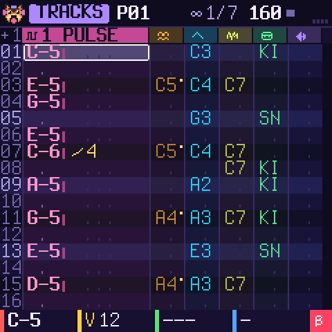
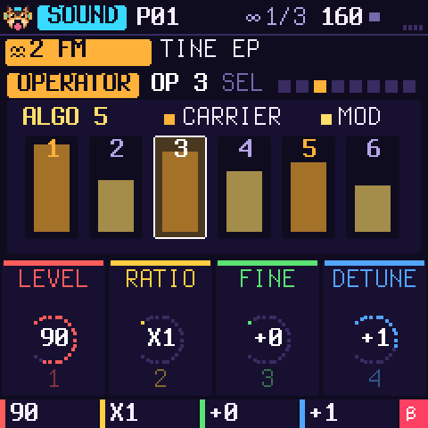
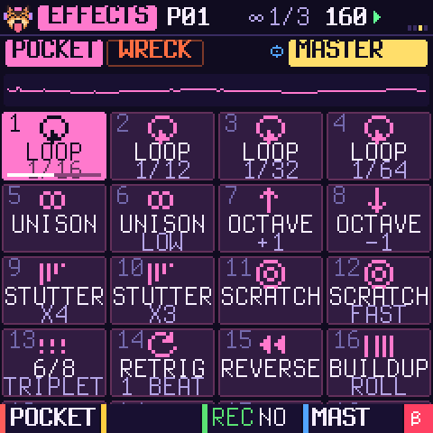
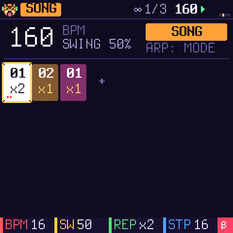
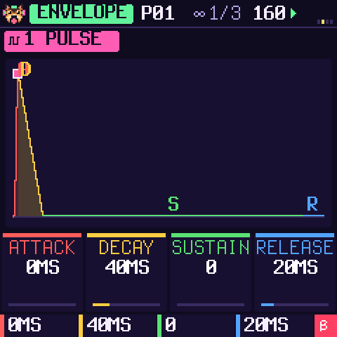
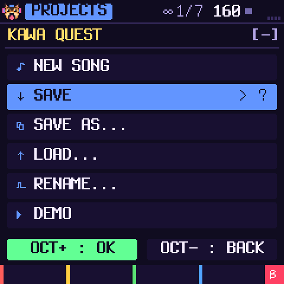

# KAWA — Pocket Tracker by Omnipotard

**English** · [Français](README.fr.md) · [Español](README.es.md)

KAWA is a tracker firmware for the **M-VAVE FM-1**, for composing in any style: pop, techno, hip hop,
ambient, jazz, rock, video game music, chiptune, breakcore… It has six tracks, each with its own engine: pulse, 4-bit wave, noise, 6-operator FM, drum kit or sample. You write
patterns, chain them into a song, and play 32 live effects in the style of a Pocket Operator. "Magic" tools
write beats, melodies and break chops for you. The screen speaks English, French or Spanish.

| | | |
| --- | --- | --- |
|  |  |  |
|  |  |  |

> **Status: 0.3, beta.** KAWA builds for the FM-1 and passes every check of its platform: size, memory,
> hardware access, and an install path tested against simulated power cuts. It runs in the simulator and in
> the web emulator. It has **not been tried on a real FM-1 yet**. Installing an unofficial firmware is at
> your own risk: read [Install](#install) and [Back to the official firmware](#back-to-the-official-firmware)
> before you start.

**The manual**, with illustrated tutorials (a new song, writing a pattern, chaining patterns, saving):
[docs/manual/en.html](docs/manual/en.html) ([FR](docs/manual/index.html), [ES](docs/manual/es.html)).

## Composing with a tracker

A tracker is a way of composing that is very different from the usual music software (a DAW):

- **Time runs down.** Each row is a step (a sixteenth note), each column a track, and each cell says what to
  play at that exact step: a note, its volume and an effect. You read the song like a scrolling score.
- **You write with the keys,** note by note, at the exact spot, with no mouse and no piano roll: the grid is
  always the same.
- **Effects are written in the cell,** to the step (arpeggio, glide, roll, volume…), instead of automation
  curves.
- **The song is a list of short patterns,** each played N times, instead of clips laid on a timeline.

The manual explains it with the screen in front of you, then walks the whole way, from an empty song to a
finished one.

## Try it in your browser

The firmware itself, compiled to WebAssembly, runs in [`emulateur/index.html`](emulateur/index.html), with
the FM-1's panel around it. Press **POWER ON**, then **PLAY**: the "KAWA QUEST" demo plays. You can drop
your own sounds on it and send them to your FM-1 over USB.

## What's inside

- **A real tracker.** 32 patterns of 1 to 32 rows, two effects in every cell, out of 17 (arpeggio, glide,
  vibrato, roll, bend, chance, delay, cut, reverse, pitch, shape, crush, volume slide, pan, sample offset,
  HOP to a row, END of the pattern), an adjustable row step (REC held + SELECT), inserting and deleting rows,
  solo, undo and redo (SAVE held + OCT− / OCT+).
- **Tables and a groove, as on the M8.** Each track has a table: 16 steps played inside every note (pitch,
  volume, a trick each: HIT, CUT, VIB…), for chip arpeggios, rolls, pitch drops. The groove sets the ticks of
  each row in turn (7 5, 8 4, 4 4 4…), in place of the swing.
- **A chain that makes a song.** Each step of the chain plays a pattern 1 to 16 times; the CLONE tool makes
  a variation in one key press and adds it to the chain.
- **A real projects menu.** New song, save, save as (slot and name), load, rename, demo. There are four
  slots, one of them the autosave.
- **Six engines, chosen per track** with SELECT on the SOUND page. The FM track (only one, to keep the FM-1
  some headroom) sets its 6 operators one by one.
- **Sound design.** Every sound has an ADSR drawn in the knobs' colours, an effect of its own (filters,
  distortion, crush, decimate, ring, tremolo, wah), an LFO locked to the tempo and a MODULATION page. The
  master has its own effect, a reverb, an echo and a limiter. A sample editor sets where a sample starts and
  ends, places its slices by hand, normalises it and plays it backwards, without touching the sound.
- **8 drum kits**, synthesised: acoustic, hip hop, techno, dub-reggae, lo-fi, Game Boy, SNES and percussion.
  Then **six original breaks** to cut into 16 slices (SOLEIL, GRELOT, TENDU, ABYSSE, MAMBO, GRENIER: each its
  own groove, kit and record), and **your own samples** (4 slots).
- **One knob, one colour.** KNOB 1 red, 2 yellow, 3 green, 4 blue, on every page. The bottom line says what
  each one does. HOME held opens the help of the page you are on.
- **Three themes** (KAWA, GAME BOY, BONBON), the **MIDI clock** out or in (KAWA follows another machine's
  tempo and START / STOP), and a CPU meter.
- **A dog** with headphones who greets you at power-on and lives in the corner of the screen.

## Install

You need the package `release/kawa-0.3.fwsc` (or your own build), a USB data cable, and Python 3 with
`pip3 install mido python-rtmidi`.

```sh
python3 tools/fm1_install.py --info                 # what the connected FM-1 runs
python3 tools/fm1_install.py release/kawa-0.3.fwsc  # asks before writing, then restarts into KAWA
```

What protects your FM-1:

- The whole package is checked before anything is erased. A damaged package is refused, and the old
  firmware stays.
- The chip's bootloader is never written.
- An install that was cut off resumes at the next power-on.
- Hold **OCT−** while switching on for the USB rescue. If KAWA crashes twice at start-up, the FM-1 goes
  there by itself.

The details are in [BUILDING.md](BUILDING.md) and in the manual.

## Back to the official firmware

1. Your KAWA projects will be lost: the official firmware cannot read them.
2. Plug the FM-1 into a stable power supply, with a USB data cable.
3. Install M-VAVE's official firmware **V15** with **M-UPGRADE**. If KAWA misbehaves, open the USB rescue
   first (OCT− held while switching on).
4. Before the official tool writes anything, KAWA checks that it is M-VAVE's own updater, and that the
   package's boot area is exactly the one on your FM-1. Otherwise nothing is written and KAWA keeps running.
5. **Unplug nothing during the transfer.** This is the most delicate step, because the official firmware
   rewrites the bootloader too. If it stops, plug back in and start again.
6. `python3 tools/fm1_install.py --info` should answer `FM-1_015`.

## Your samples on the FM-1

```sh
python3 tools/kawa_samples.py put 1 my-sound.wav    # into MY 1 (KAWA stopped)
python3 tools/kawa_samples.py list
```

The sound is made mono, 22 kHz and normalised, up to 1.66 s per slot. On a SAMPLE track, choose
SOURCE = MY 1 to 4.

## Build it

- `tests/run_host.sh [script]` runs KAWA on your computer: screens as PNG, sound as WAV.
- `web/make_emulator.sh` builds the web emulator. It needs clang with the wasm32 target, and wasm-ld.
- `./build.sh` builds the FM-1 package. It needs the JieLi compiler (`tools/get_toolchain.sh`) and three
  files of the JieLi AC79 SDK. See [BUILDING.md](BUILDING.md).
- `tests/run_loader_tests.sh` tests the install path: damaged packages, power cuts, an unknown chip.
- `tests/run_kits_test.sh` and `tests/breaks_check.py` measure the drum kits and the breaks.
- `tests/run_features_test.sh` plays HOP, END, two effects in a cell, the tables, the groove, the sample edit
  and the MIDI clock in through the audio interrupt; `tests/run_format_test.sh` loads projects saved by 0.2.
- `tests/run_stress_test.sh` plays every sound, effect, live effect, table and groove at the ends of their knobs
  (17 minutes of sound) under UBSan, and stops at the first number that wraps (a click on the FM-1).

## Support KAWA

KAWA is free and open. If you enjoy what I do, consider supporting me! Every little bit means the world!
**[Buy me a beer on Ko-fi](https://ko-fi.com/omnipotard)**.

## Credits and licence

KAWA by Omnipotard. GPL-3.0-only: you may use, change and share it, and whoever receives a firmware built
from it also receives its source code. It is built on [Dinghy](https://github.com/zvenson/dinghy)
(zvenson), [Felucca](https://github.com/hugelton/Felucca) (Leo Kuroshita, Hügelton Instruments) and
[SLOOP](https://github.com/isod89/sloop-fm1) (isod89). The FM engine is msfa (Dexed, Apache-2.0), in
Felucca's port. The details are in [LICENSING.md](LICENSING.md). "M-VAVE" and "FM-1" belong to their owners;
KAWA is neither made nor endorsed by them.
