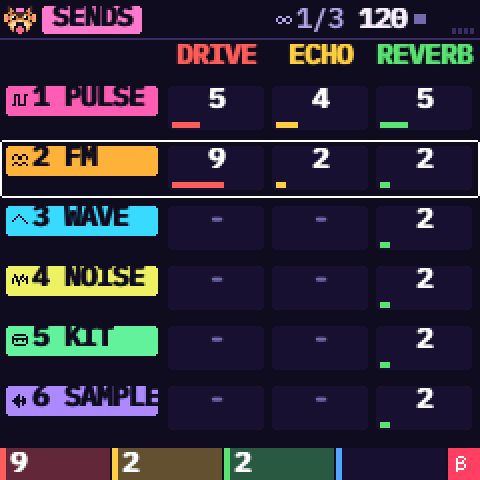

# KAWA — Pocket Tracker for the M-VAVE FM-1

**[▶ Open the KAWA website](https://guizmoh.github.io/Kawa-Tracker-Fm1/)** — [Install](https://guizmoh.github.io/Kawa-Tracker-Fm1/#install) · [Emulator](https://guizmoh.github.io/Kawa-Tracker-Fm1/emulator/index.html) · [Manual](https://guizmoh.github.io/Kawa-Tracker-Fm1/manual/index.html) · [Samples](https://guizmoh.github.io/Kawa-Tracker-Fm1/samples.html)

**English** · [Français](README.fr.md) · [Español](README.es.md)

KAWA is a free tracker firmware for the **M-VAVE FM-1**, made above all for **chiptune and IDM**: 4-bit waves,
pulse and noise like the old consoles, FM, breakbeats cut into slices, rolls and ratchets, stutter and glitch
live effects, tables, a groove, a drive on every track. (It can do other styles, but that is what it is built
for.) Six tracks, a step sequencer you write with the keys, a chain of patterns that makes a song, and 32 live
effects. The screen speaks English, French or Spanish.

> **Beta 0.6 — not yet tried on a real FM-1.** It passes every check we can run without the hardware (size,
> memory, an install tested against simulated power cuts, the simulator and the web emulator). Installing an
> unofficial firmware is at your own risk, but you can always [go back to the official one](#go-back-to-the-official-firmware).

## Start here

| | |
| --- | --- |
| **1. Install** | **[Install from your browser](https://guizmoh.github.io/Kawa-Tracker-Fm1/)** (Chrome or Edge: plug the FM-1 in, click *Install KAWA*). Or download [`kawa-0.6.fwsc`](kawa-0.6.fwsc) and use the [launcher](#install) for your computer. |
| **2. Play** | Switch the FM-1 on and press any key. Press **REC**, play the keys, press **PLAY**. **HOME held** shows the help of the page you are on. |
| **3. Learn** | **[The manual](https://guizmoh.github.io/Kawa-Tracker-Fm1/manual/index.html)** ([FR](https://guizmoh.github.io/Kawa-Tracker-Fm1/manual/fr.html), [ES](https://guizmoh.github.io/Kawa-Tracker-Fm1/manual/es.html)): five short tutorials, from an empty song to a saved one. Or try KAWA right now in the **[web emulator](https://guizmoh.github.io/Kawa-Tracker-Fm1/emulator/index.html)**. |
| **4. Your sounds** | The **[sample importer](https://guizmoh.github.io/Kawa-Tracker-Fm1/samples.html)** puts your own WAV / MP3 / OGG / FLAC files into KAWA over USB. |

| | | |
| --- | --- | --- |
|  |  |  |
|  |  |  |

## What you get

- **A tracker.** Each row is a step, each column a track, each cell a note, a volume and up to two effects (arpeggio,
  glide, roll, chance, delay, reverse, HOP, END…). Patterns of 16, 32 or 64 steps, chained into a song.
- **Six tracks, each with an engine:** pulse, 4-bit wave, noise, 6-operator FM (one track), drum kit or sample.
  Factory sounds for all of them, an ADSR, an effect, an LFO and a modulation page on every sound.
- **Made for chiptune and IDM:** 8 synthesised drum kits and 6 breaks to cut into 16 slices, a **table** on every
  track (a little sequence played inside each note: chip arpeggios, pitch drops, ratchets), a **groove** (7 5, 8 4…),
  Euclid, random and chop tools, 32 live effects (stutter, scratch, retrig, build-up…), a drive per track.
- **Your own samples** (4 slots), with an editor: start, end, slices, normalise, reverse.
- **Easy to live with.** The bottom line always says what the four knobs do (KNOB 1 red, 2 yellow, 3 green, 4 blue).
  HOME held opens the help. **Undo / redo cover patterns and sounds** (10 steps). A sound you edited is never replaced
  by mistake. The song is autosaved, plus three project slots. Three themes, four fonts, MIDI clock in and out, a metronome.

## Controls at a glance

| Button | What it does |
| --- | --- |
| **HOME** | The tracks. Held: the help of the page you are on. **HOME + PLAY**: panic (everything stops) |
| **SEQ** | The step grid. **OCT− / OCT+** there: 16, 32 or 64 steps |
| **EDIT** | The sound of the track: SOUND, SOUND 2, (FM operators / sample edit), EFFECT, TABLE. Press again: next page |
| **LFO** | LFO, then MODULATION |
| **ENV** | ENVELOPE, then MIX (levels, pan, sends, master) |
| **FX** | SENDS (drive, echo, reverb per track), then LIVE (32 live effects), then back. Held: LIVE while you hold it |
| **SCL** | SCALE, then MAGIC (beats, melodies, break chops), then back |
| **GLO** | SONG (the chain), GROOVE, OPTIONS (theme, language, clock, font, metronome) |
| **SAVE** | PROJECTS (it blinks while there are unsaved changes). Held: the tools (OPTIONS, UNDO, REDO, CLEAR, COPY, PASTE, RANDOM). **OCT− / OCT+** while held: undo / redo |
| **PLAY**, **REC** | Play / stop; record (the keys write at the cursor, or on the beat while playing) |
| **ARP** | Not an arpeggiator: the **clear / shift** key. A tap on TRACKS clears the cell. Held: + SELECT inserts or deletes a row, + KNOB 3 / 4 edits the cell's second effect, + PRESETS picks the next engine |
| **OCT− / OCT+** | The octave of the keys (other uses on the pages above: bank, add / remove, OK / back) |

| Encoder | What it does |
| --- | --- |
| **SELECT** | Turns the pages of EDIT, LFO, ENV, FX and GLO. Elsewhere: the row, the 16-step page, the menu |
| **ALGORITHM** | The track. On SONG the entry of the chain, on GROOVE the step, on OPTIONS the metronome |
| **PRESETS** | The factory sound (on the first SOUND page), or the page's cursor (operator, table row, slice); the pattern elsewhere |

A **yellow bar** fills at the bottom of the screen when holding a button is about to open something. The 27 keys
play notes on the current track. Everything is explained, with screens, in [the manual](https://guizmoh.github.io/Kawa-Tracker-Fm1/manual/index.html).

## Install

You need a USB **data** cable (not a charge-only one). Switch the FM-1 on, plug it in, close every other MIDI program
(a DAW, M-UPGRADE), then pick one way:

- **From your browser (Chrome, Edge, Opera):** open the [home page](https://guizmoh.github.io/Kawa-Tracker-Fm1/) and click *Install KAWA*.
- **Launcher** (needs [Python 3](https://www.python.org/downloads/)): download this repository (green *Code* button,
  *Download ZIP*), unzip it, then **Windows**: double-click `INSTALL-Windows.bat`; **Mac**: double-click
  `INSTALL-Mac.command` (the first time: right click, Open); **Linux**: `./INSTALL-Linux.sh`.

Either way the package is checked before anything is erased, you are asked to confirm, and the FM-1 restarts into
KAWA. **Do not unplug it while it writes.** A cut install resumes at the next power-on. The chip's bootloader is never
written. If KAWA ever fails to start twice in a row, the FM-1 opens the USB rescue by itself (or hold **OCT−** while
switching on): then run the installer again.

## Go back to the official firmware

1. Your KAWA projects are lost: the official firmware cannot read them.
2. Use a stable power supply and a USB data cable. If KAWA misbehaves, open the USB rescue first (OCT− held while switching on).
3. Install M-VAVE's official firmware **V15** with **M-UPGRADE**. KAWA first checks that the tool is M-VAVE's own and that
   its package matches your FM-1; otherwise nothing is written and KAWA keeps running.
4. **Unplug nothing during the transfer** (the official firmware also rewrites the bootloader). If it stops, plug back in and start again.

## Your samples

The **[sample importer](https://guizmoh.github.io/Kawa-Tracker-Fm1/samples.html)** (Chrome or Edge) converts your files
(mono, 22 kHz, normalised, up to 1.66 s each) and sends up to four to the slots MY 1 to MY 4, with KAWA **stopped**.
On a SAMPLE track, choose SOURCE = MY 1 to 4. Without a browser:
`python3 install/kawa_samples.py put 1 my-sound.wav` (and `list`).

## Something wrong?

- **The installer does not find the FM-1:** a data cable, the FM-1 switched on, no other MIDI program open; for the browser, Chrome or Edge.
- **Stuck on the dog:** press any key, KAWA waits for you.
- **Silence:** KAWA starts on an empty song. Write notes (REC, then the keys), or load the demo: SAVE, DEMO, OCT+, PLAY.
- **PRESETS does not change my sound:** you edited it (`*`): it shows the next one in gold, **OCT+** loads it.
- **I made a mistake:** hold SAVE and press OCT− (undo), or SAVE then UNDO.
- **The click is in my recording:** the metronome is also in the USB audio, turn it off (GLO, third page).
- More answers in the [manual](https://guizmoh.github.io/Kawa-Tracker-Fm1/manual/index.html), under *Help*.

## Support KAWA

KAWA is free and open. If you enjoy what I do, consider supporting me! Every little bit means the world!
**[Buy me a beer on Ko-fi](https://ko-fi.com/omnipotard)**.

## Credits and licence

KAWA by Omnipotard. GPL-3.0-only: you may use, change and share it, and whoever receives a firmware built from it
also receives its source code. Built on [Dinghy](https://github.com/zvenson/dinghy) (zvenson),
[Felucca](https://github.com/hugelton/Felucca) (Leo Kuroshita, Hügelton Instruments) and
[SLOOP](https://github.com/isod89/sloop-fm1) (isod89); the FM engine is msfa (Dexed, Apache-2.0). Details in
[LICENSING.md](LICENSING.md). "M-VAVE" and "FM-1" belong to their owners; KAWA is neither made nor endorsed by them.

*For developers:* the source, the build, the tests and the file formats are in [`source/`](source/BUILDING.md).
